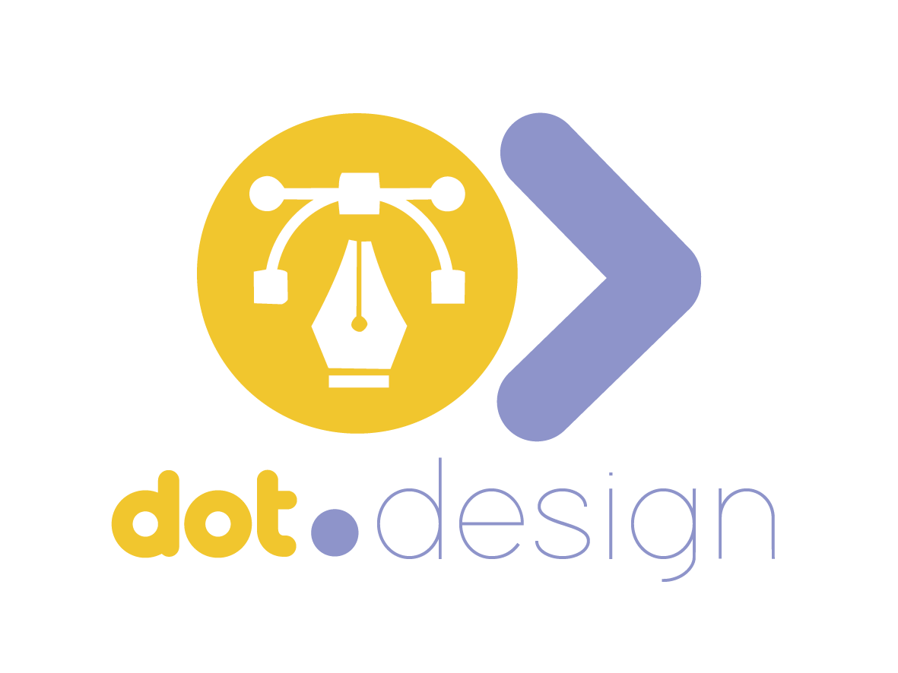

<div align="center">



<br /><br />

**A design studio for businesses: make a poster, a social post, a flyer, a business card or a short animation, on brand, in the browser.**

<br />

Part of the Dot Ecosystem &nbsp;·&nbsp; live at `https://design.infodot.co.za` &nbsp;·&nbsp; Laravel 13 &nbsp;·&nbsp; PHP 8.3+ &nbsp;·&nbsp; PostgreSQL

</div>

---

## What it is

Dot.Design is the visual-creation platform of the Dot ecosystem. A person who is not a designer says what they want to make; the studio proposes a size and a starting point, fills it with their business details, and opens an editor where everything stays editable. A professional gets the full panels, layers, rulers and guides over the same document.

**What you can do today**

- **Start from a goal.** "What would you like to make?" leads to a short, skippable brief (goal, business, offer, style), then a ranked list of the 58 curated templates with a plain reason for each, or a blank page at any of the catalogued sizes (social, print, document, video; ZA business card and A-series formats included).
- **Edit.** Text, shapes (including paths), pictures, 172 icons, groups, patterns and gradients; 18 self-hosted fonts; snapping and smart guides, alignment, undo and redo, multi-page designs, autosave with conflict detection, a recovery journal for a closed tab or a lost connection.
- **Two modes over one document.** **Simple** (default) shows one panel with only what applies to the selection, in plain words. **Pro** shows every property, layers, rulers, guides and a grid. The mode is a per-person preference; it never changes the data.
- **Brand kits.** Colours, fonts, type styles, voice, logos and contacts per workspace. Applying a changed kit to old designs is always a reviewed list, never silent.
- **Output.** PNG, JPG, SVG, PDF (pages as pictures at a chosen resolution; text is not selectable), animated GIF and WebM where the browser can record, all made in the browser from the same renderer you see on screen; smart resize to other sizes; copies.
- **Work together.** Workspaces are InfoDot companies (Jetstream teams) with owner, admin, editor and reviewer roles; version history with restore; share links (view or comment, expiring, revocable); comments with @mentions; review requests and approvals with separation of duties; an audit trail.
- **Assistant (optional).** With an Anthropic key: describe an idea and get an editable draft, ask for an improvement, get marketing copy. The model only proposes; a person applies, as one undoable step, after a version snapshot. Without a key the assistant says it is off and the deterministic parts (brief recommender, automatic quick fixes, resize suggestions) still work.
- **Integrations, each off until configured.** Dot.Notify (email on shares, reviews, comments), Dot.Files (file an export), InfoDot membership webhook, Dot.Analytics (two daily counts). Platforms without a usable contract are listed honestly on the Integrations page, not faked.
- **Design-system catalogue.** Versioned tokens and component definitions with the ecosystem platforms that consume them (`/design-system`), written only by platform operators.

**Deliberately not built** (and the interface does not pretend): real-time multi-cursor editing (shared hosting cannot run a WebSocket server; concurrent saves get a conflict screen), background removal, publishing to social networks, a stock-photo library, AI image generation, MP4 export, vector PDF. Reasons in `docs/R45_ARCHITECTURE.md` section 8.

## How it is built, on one page

```
 browser                                                       server (Laravel 13, PHP 8.3+, PostgreSQL)
 ──────────────────────────────────────────────                ──────────────────────────────────────────────
 resources/js/studio/                                          routes/studio/*.php   one file per area
   doc/      document model, schema (shared JSON)                app/Http/Controllers/Studio/**  thin controllers
   engine/   store, commands + undo, selection,                  app/Services/Design/**   DocumentSanitiser, PageStore (CAS),
             transform, snap, text layout,                         VersionService, ShareService, ReviewService,
             ONE SVG renderer, autosave, recovery                  TemplateInstantiator, BriefRecommender, BrandService,
   output/   export (png jpg svg pdf gif webm),                    Assistant/*  (Anthropic Messages API, proposals only)
             animation, smart resize                             app/Services/Integrations/**  Notify, Files, InfoDot webhook
   ui/       shell, Simple and Pro panels, modules             app/Models  HasWorkspaceScope: a row you may not see is a 404
   assist/ collab/ pages/  assistant, comments, review, pages    database/templates/*.php  the curated library (PHP builder DSL)
 resources/css/ds/  tokens + components ("The Light Table")    resources/design/document-schema.json   THE document contract
 public/fonts/{ui,design}  self-hosted woff2, no CDN            read by PHP (validate, clamp) AND JS (defaults, migrate)
```

- **One document model, two runtimes.** `resources/design/document-schema.json` is read by both the PHP sanitiser and the JS engine. The server never trusts the client document: it re-validates, clamps, strips unknown keys and checks asset ownership on every save. Saves are compare-and-swap on a page `revision`; "Saved" appears only after a `2xx`.
- **One renderer.** The page is drawn as SVG by one function, used for the screen, thumbnails and every export, so what you see is what you download. Fonts are self-hosted and embedded when exporting.
- **No framework in the editor.** Vanilla ES modules built by Vite. Livewire and Alpine remain only for the Jetstream account pages. No script, stylesheet or font loads from a CDN at runtime.
- **Tenancy.** Workspace = Jetstream team, synced from InfoDot. A role is read from the database on every request, so a removal bites at once.
- **Private files.** Uploads and thumbnails live on a private disk (`storage/app/private/design-assets`), re-encoded through GD to drop metadata, and are served only through policy-checked routes.
- **Shared-host runtime.** No Node on the host, no daemon: the frontend is built on the CI runner, the scheduler and the queue worker are started by cron (`queue:work --stop-when-empty`).

The design language is "The Light Table" (`DESIGN.md`, `docs/R45_DS.md`).

## Run it locally

Requirements: PHP 8.3 or newer with `gd` (JPEG, PNG, WebP), `intl`, `bcmath`, `mbstring`, `fileinfo`, `curl` and a database driver; Composer; Node 22.

```bash
cp .env.example .env
composer install
php artisan key:generate
# SQLite is the quickest local database: set DB_CONNECTION=sqlite and DB_DATABASE=/absolute/path/dev.sqlite, then
touch /absolute/path/dev.sqlite
php artisan migrate
php artisan design:seed-templates          # the 58 curated templates
php artisan db:seed --class=DesignSystemSeeder
npm ci && npm run build                    # or `npm run dev` for hot reload
php artisan serve
```

There is no public sign-up. Create a local user in `php artisan tinker` (`User::factory()->withPersonalTeam()->create(['email' => 'you@example.test', 'password' => bcrypt('a-long-password')])`), or run `php artisan db:seed` for the development seeder. **Never run `db:seed` against production**: `DatabaseSeeder` creates a user with a known password. Grant yourself operator rights (curated templates, design-system catalogue) with `User::where('email', ...)->update(['is_platform_operator' => true])`.

The assistant needs `ANTHROPIC_API_KEY`; everything else works without it. `php artisan design:preflight` tells you what is missing on any machine.

## Test it

```bash
php artisan test --compact             # PHP: feature + unit, SQLite in memory
npm run test:js                        # the editor engine, output, assistant, collaboration (node:test, no browser)
npm run build && tests/Support/signed-in-smoke.sh   # boots the app like production and walks every key page
node scripts/ops/check-vite-manifest.mjs            # every @vite entry in the views is in the build
php scripts/ops/generate-docs.php --check           # docs/API.md and docs/DATABASE.md match the code
```

CI (`.github/workflows/ci.yml`) runs the PHP suite, the JS suite with the build and manifest check, and the signed-in smoke on every pull request. `docs/TESTING.md` describes the layers.

## Deploy

Manual, from GitHub Actions: `gh workflow run deploy.yml -f confirm=deploy`. It runs the CI gate, builds the frontend on the runner, takes a rollback copy and a `pg_dump` on the host, updates the code, migrates, seeds templates, runs `design:preflight`, installs the cron lines and smoke-checks the live site. Everything the host and `.env` must have, the first-deploy checklist, rollback and the cron lines are in **`docs/deployment.md`**; what the owner does after a deploy (operator, assistant key, integrations, backups, revoking share links, deleting a workspace) is in **`docs/R45_OPERATIONS.md`**.

## Documentation index

| Read | For |
|---|---|
| `docs/deployment.md` | First deploy, routine deploys, every environment variable, host requirements |
| `docs/R45_OPERATIONS.md` | Owner runbook: first steps after a deploy, backups and restore, monitoring, rollback, revoking shares, purging a workspace |
| `docs/R45_ARCHITECTURE.md` | The contract: product shape, document model, data model, editor architecture, honest limits |
| `docs/R45_DECISIONS.md` | Every decision made during the rebuild, with the reason |
| `docs/API.md`, `docs/DATABASE.md` | Routes and tables, generated from the code |
| `docs/R45_BACKEND.md` | Pages, versions, shares, comments, reviews, activity, the capability matrix |
| `docs/R45_BUSINESS.md` | Formats, brief flow, recommender, templates, brand kits |
| `docs/R45_ENGINE.md`, `docs/R45_UI_CONTRACT.md`, `docs/R45_UI_EDITOR.md` | The editor engine API, the module registry, the workspace |
| `docs/R45_UI_CREATE.md`, `docs/R45_UI_BRAND.md`, `docs/R45_UI_COLLAB.md` | Start flow, brand studio, collaboration screens |
| `docs/R45_OUTPUT.md` | Export, animation, smart resize |
| `docs/R45_AI.md` | The assistant: what is AI, safety rules, endpoints |
| `docs/R45_LIBRARY.md` | Templates, icons, elements, and the tools that check them |
| `docs/R45_INTEGRATIONS.md` | What Dot.Design really connects to, and the owner steps on the other side |
| `docs/R45_DS.md`, `DESIGN.md` | The design system |
| `docs/R45_AUDIT.md`, `docs/R45_RESEARCH.md`, `docs/R45_SKILLS.md` | The audit that started the rebuild, the research, the design skills used |
| `docs/SECURITY.md`, `docs/ACCESSIBILITY.md`, `docs/TESTING.md` | Standards and checklists (each carries a status note saying what is built) |

`docs/CANVAS-EDITOR.md`, `CODE-ARCHITECTURE.md`, `AI-INTEGRATION.md`, `REALTIME-COLLABORATION.md`, `UI-DESIGN.md`, `UX-IMPROVEMENTS.md`, `PERFORMANCE.md` and `DEVOPS.md` are proposals written before the rebuild. Each begins with a note saying which parts were superseded; none of them describes the running system. `wiki.md` is the platform's wiki for Dot.Brain.

## License

MIT
