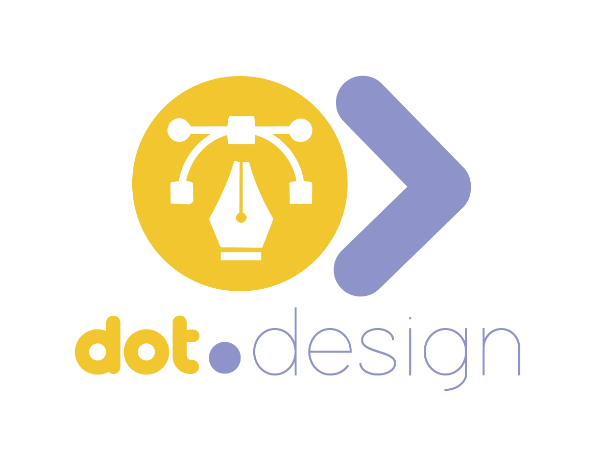

<div align="center">



<br /><br />

**The Dot Ecosystem's canvas-first AI design tool — plus a shared design-token / component-library scaffold.**

<br />

   

<br /><br />

**Part of the Dot Ecosystem** &nbsp;·&nbsp; see [Dot.Brain](https://github.com/sakhilebhayi/Dot.Brain) for the ecosystem knowledge map

</div>

---

## What is Dot.Design?

Dot.Design is the visual-creation platform in the Dot Ecosystem — a canvas-first editor paired with generative AI, aimed at producing on-brand graphics, social posts, and marketing collateral without requiring professional design skill. Users open a project, drop text/shapes/images/icons onto a canvas, optionally ask AI to generate imagery, and export the result.

**This repository currently holds two coexisting domains** (see `wiki.md` for the full detail and the open framing question this raises with Dot.Brain):

1. **Canvas / AI creation tool** — `DesignProject`, `DesignCanvas`, `DesignAsset`, `AiGenerationLog`. Per-user data. The interactive canvas editor UI itself is not yet built; the backend/data model exist ahead of the front end.
2. **Design-token / component-library scaffold** (`/design-system/*`) — `TokenSet`, `DesignToken`, `Component`, `TokenConsumptionRecord`. Deliberately global/shared (no per-user or per-team scoping), since a design system is one catalog every platform consumes.

## Core Features

- Canvas editor domain — drag-and-drop text, shapes, images, and icons (data model in place; interactive editor UI not yet built)
- AI image generation logging from text prompts, multi-provider (`AiGenerationLog.provider`: Anthropic, OpenAI, Stability, Replicate)
- Asset library — real image uploads (JPG/PNG/WebP, private storage, per-user quota) plus labelled AI placeholders; see [Uploads](#uploads)
- Design-token / component catalog — versioned color/type/spacing/motion tokens, reusable component definitions, and a tracking table of which ecosystem platform consumes which token-set version
- Ecosystem SSO via Sanctum handoff token (`EcosystemAuthController`)

## Uploads

Signed-in users can upload images from the asset panel in a project's editor.

| | |
|---|---|
| Accepted | JPG, PNG, WebP. The type is read from the file's content, never its name or the browser's claim. |
| **Not accepted** | **SVG** (an SVG can carry script, so it is refused outright), GIF, anything else. |
| Size | 8 MB per file (`design.assets.max_kilobytes`). |
| Dimensions | Each side 16 to 8000 px and at most 40 megapixels. Checked from the header, before the image is decoded. |
| Quota | 200 MB of stored bytes per user (`DESIGN_ASSET_QUOTA_MB`), checked inside a transaction that locks the user row. |
| Rate limit | 20 uploads per user per minute (`DESIGN_ASSET_UPLOADS_PER_MINUTE`). |
| Duplicates | Identical content from the same user returns the existing asset instead of storing a second copy and costs no quota. If that asset sits in another project it moves to the library so both places can see it. |

**What is stored.** The image is decoded and re-encoded with GD, which drops EXIF (including GPS) and anything appended after the image data; EXIF orientation is applied to the pixels first. Animated WebP keeps only its first frame. The file is written to a private disk (`storage/app/private/design-assets`, disk `design_assets`) under a random name, with its sha256, size, dimensions and MIME type recorded on the `design_assets` row. `content_hash` is the hash of the stored bytes.

**How it is served.** Only through `GET /design/assets/{asset}/file`, behind login and `DesignAssetPolicy`; another user's asset is a 404. The response carries the stored `Content-Type`, `X-Content-Type-Options: nosniff`, a sandboxing `Content-Security-Policy`, `Cache-Control: private` and an ETag. There is no public URL.

**Deleting.** Deleting an asset removes its file from the disk unless another row still points at the same path. Deleting a project moves its uploads to the library.

**Assets and projects.** An asset belongs to one project or to the user's library (no project). The editor panel shows the current project's assets and the library. AI results are filed under the project that asked for them and stay labelled as placeholders; they are external URLs, not files on our disk.

### Not supported

- SVG upload (deliberate; see above).
- Real AI image generation. No provider is connected; the mock driver returns placehold.co stand-ins that the UI labels "Placeholder (no AI provider connected)".
- Collaboration or sharing of assets between users or teams. Assets are per user.

### Upgrade notes

1. Run `php artisan migrate` (adds `design_project_id`, `disk`, `content_hash`, `width`, `height` to `design_assets`; all nullable, existing rows stay valid).
2. The new `design_assets` disk is defined in `config/filesystems.php`. Point `DESIGN_ASSET_DISK` at another private disk (for example an S3 bucket with no public access) to move storage; never at `public`. Make sure `storage/app/private` is writable and included in backups.
3. The PHP `gd` extension (with WebP support) is required for sanitising. Without it, uploads are still accepted but stored **unmodified**, so EXIF/GPS is not stripped; each such row has `meta.reencoded = false`. Set `DESIGN_ASSET_REENCODE=false` to choose that deliberately. Check with `php -m | grep gd`.
4. GD holds a decoded image at 4 bytes per pixel, so a 40 megapixel image needs roughly 160 MB. Images that would not fit in PHP's `memory_limit` are refused with a clear message instead of crashing; raise `memory_limit` if you want the full range.
5. If the web server or a proxy limits request bodies (nginx `client_max_body_size`, PHP `upload_max_filesize` / `post_max_size`), keep them at 8 MB or above or users will see "larger than the server accepts".

## Domain Models

**Canvas / AI tool:**
- **DesignProject** — canvas project with metadata (type, dimensions, unit)
- **DesignCanvas** — one or more pages per project, JSON `elements` blob
- **DesignAsset** — uploaded images (stored on a private disk) and AI placeholder references
- **AiGenerationLog** — one row per AI generation request

**Design-token / component-library scaffold:**
- **TokenSet** — a versioned group of tokens (e.g. "Core Palette")
- **DesignToken** — a single color/type/spacing/motion token
- **Component** — a reusable UI component definition
- **TokenConsumptionRecord** — which ecosystem platform consumes which token set, pinned to which version

## Tech Stack

| Layer | Technology |
|---|---|
| Framework | Laravel 12 |
| Language | PHP 8.4 |
| Frontend | Livewire 3 · Alpine.js 3 · Tailwind CSS |
| Database | PostgreSQL 16 (shared across the Dot Ecosystem) |
| Realtime | Laravel Reverb |
| Auth | Laravel Sanctum + Jetstream (teams, 2FA) |
| AI | Multi-provider: Anthropic, OpenAI, Stability, Replicate |
| Storage | AWS S3 / Local (Flysystem) |
| Search | Laravel Scout · Meilisearch (planned) |
| Queue | Redis · Laravel Horizon (planned) |

## Quick Start

```bash
git clone <this-repo-url> Dot.Design
cd Dot.Design
cp .env.example .env
composer install
npm install && npm run build
php artisan key:generate
php artisan migrate
php artisan db:seed
php artisan serve
```

> **Ecosystem SSO:** Set `DB_*` env vars to the shared Dot Ecosystem PostgreSQL instance. Users authenticated elsewhere in the ecosystem gain access automatically via Sanctum handoff tokens through `EcosystemAuthController`.

## Ecosystem

**Dot.Design** is one of roughly 20 platforms in the Dot Ecosystem, connected via shared PostgreSQL and Sanctum SSO, and unified by a shared knowledge repository, **Dot.Brain**. See `wiki.md` in this repo for Dot.Design's own account of what's implemented, and Dot.Brain's `platforms/dot-design.md` for the ecosystem-ingested view (currently a known, tracked mismatch — see `wiki.md` §1.1).

## License

MIT
